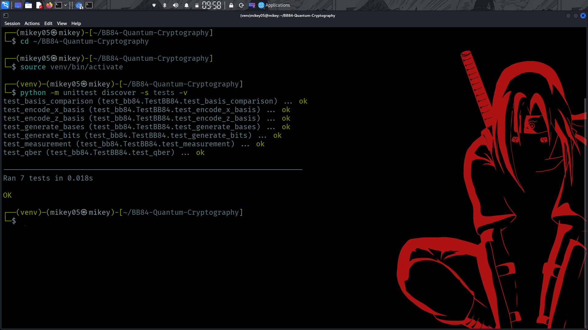

# BB84 Quantum Key Distribution (QKD) Simulation

## Project Overview

This project implements the BB84 quantum key distribution protocol using Python and NumPy. It simulates quantum-state preparation, measurement, key sifting, and an intercept-and-resend eavesdropping attack.

The primary objective is to demonstrate how quantum measurement disturbance can reveal the presence of an eavesdropper.

## Objectives

- Implement the BB84 quantum key distribution protocol.
- Simulate quantum states using state vectors.
- Implement Alice's encoding and Bob's measurement.
- Perform basis comparison and key sifting.
- Simulate Eve's intercept-and-resend attack.
- Calculate Quantum Bit Error Rate (QBER).
- Compare secure and attacked communication channels.
- Visualize experimental results.

## Technologies Used

- Python 3
- NumPy
- Matplotlib
- Python Unittest
- Kali Linux

## Project Architecture

```text
BB84-Quantum-Cryptography/
│
├── main.py
├── config.py
├── requirements.txt
├── README.md
│
├── bb84/
│   ├── __init__.py
│   ├── alice.py
│   ├── bob.py
│   ├── quantum.py
│   ├── eve.py
│   ├── sifting.py
│   └── security.py
│
├── experiments/
│   └── run_experiments.py
│
├── results/
│   └── qber_comparison.png
│
└── tests/
    └── test_bb84.py
```

## BB84 Protocol

BB84 is a quantum key distribution protocol introduced by Charles Bennett and Gilles Brassard in 1984.

It uses two quantum bases:

- **Z basis (Computational basis):** |0⟩ and |1⟩
- **X basis (Diagonal basis):** |+⟩ and |−⟩

Alice randomly generates bits and encoding bases. Bob independently selects measurement bases. They publicly compare their bases and retain only positions where their bases match.

## Eavesdropping Simulation

The project implements an intercept-and-resend attack:

1. Eve intercepts the transmitted quantum states.
2. Eve randomly selects a measurement basis.
3. Eve measures each state.
4. Eve prepares and resends a new state based on her measurement.
5. Bob measures the resent states.
6. Alice and Bob compare their sifted keys to estimate errors.

## Quantum Bit Error Rate (QBER)

QBER measures the proportion of differing bits between Alice's and Bob's compared keys.

**Formula:**

QBER = (Number of errors / Total compared bits) × 100

For an ideal BB84 channel with no eavesdropping, the expected QBER is 0%.

For an ideal intercept-and-resend attack where Eve randomly chooses between the two BB84 bases, the expected QBER is 25%.

## Experimental Results

The simulation demonstrated:

| Experiment | Observed QBER |
|---|---:|
| Without Eve | 0.00% |
| With Eve | Approximately 25% |

One experimental run produced 0.00% QBER without Eve and 25.19% QBER with Eve.

Results vary slightly because of random sampling.

## Visualization

The project generates a comparison chart:

`results/qber_comparison.png`

The chart compares the measured QBER in the two experiments against the theoretical 25% intercept-and-resend benchmark.

## Installation

Clone the repository:

```bash
git clone YOUR_GITHUB_REPOSITORY_URL
cd BB84-Quantum-Cryptography
```

Create and activate a virtual environment:

```bash
python3 -m venv venv
source venv/bin/activate
```

Install dependencies:

```bash
pip install -r requirements.txt
```

## Running the Experiment

Run from the project root:

```bash
python -m experiments.run_experiments
```

## 🧪 Testing

The project includes seven automated unit tests covering:

- Random bit generation
- Quantum state preparation
- Basis selection
- Measurement operations
- Key sifting
- QBER calculation
- Intercept-and-resend attack detection
### Test Execution Screenshot


- 
- ## ⚠️ Research Limitations

- This project is a software-based BB84 simulation.
- It does not use real quantum hardware.
- Quantum noise and hardware imperfections are not fully modeled.
- The simulation demonstrates the basic BB84 protocol and an intercept-and-resend attack.
- It is an educational and experimental implementation, not a production-ready QKD system.

**Test Result:** 7 tests passed successfully.


The current test suite contains seven automated tests.
All seven tests pass successfully.

## 📊 Experimental Results

| Experiment | Expected QBER |
|---|---:|
| Without Eve | 0% |
| With intercept-and-resend attack | Approximately 25% |

### Security Observation
The intercept-and-resend attack introduces errors into the shared key. 
This increases the Quantum Bit Error Rate (QBER), helping Alice and Bob detect potential eavesdropping.
