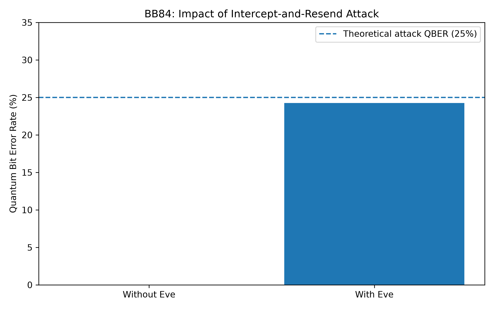

# BB84 Quantum Key Distribution (QKD) Simulation

## Project Overview

This project implements a software-based simulation of the BB84 quantum key distribution protocol using Python and NumPy.

It simulates quantum-state preparation, measurement, basis comparison, key sifting, and an intercept-and-resend eavesdropping attack.

The primary objective is to demonstrate how quantum measurement disturbance can introduce errors into a shared key and help reveal potential eavesdropping.

## Objectives

- Implement the fundamental BB84 protocol.
- Represent quantum states using state vectors.
- Simulate Alice's encoding and Bob's measurement.
- Perform basis comparison and key sifting.
- Implement Eve's intercept-and-resend attack.
- Calculate Quantum Bit Error Rate (QBER).
- Compare communication with and without an eavesdropper.
- Visualize experimental results.

## Technologies Used

- Python 3
- NumPy
- Matplotlib
- Python unittest
- Kali Linux

## Project Architecture

```text
BB84-Quantum-Cryptography/
│
├── bb84/
│   ├── __init__.py
│   ├── alice.py
│   ├── bob.py
│   ├── quantum.py
│   ├── eve.py
│   ├── sifting.py
│   └── security.py
│
├── experiments/
│   └── run_experiments.py
│
├── results/
│   └── qber_comparison.png
│
├── screenshots/
│   └── test_results.png
│
├── tests/
│   └── test_bb84.py
│
├── requirements.txt
├── .gitignore
└── README.md
```

## BB84 Protocol

BB84 was introduced by Charles Bennett and Gilles Brassard in 1984.

It uses two quantum bases:

- **Z basis (Computational basis):** |0⟩ and |1⟩
- **X basis (Diagonal basis):** |+⟩ and |−⟩

Alice randomly generates bits and encoding bases. Bob independently chooses measurement bases.

They publicly compare their bases and retain only positions where their bases match. This process is called **key sifting**.

## Intercept-and-Resend Attack

The project simulates an intercept-and-resend attack:

1. Eve intercepts the transmitted quantum states.
2. Eve randomly selects a measurement basis.
3. Eve measures each state.
4. Eve prepares and resends a new state based on her measurement.
5. Bob measures the resent states.
6. Alice and Bob compare their sifted keys to estimate errors.

## Quantum Bit Error Rate (QBER)

QBER measures the percentage of differing bits between Alice's and Bob's sifted keys.

**Formula:**

QBER = (Number of errors / Total compared bits) × 100

For an ideal noiseless BB84 channel without eavesdropping, the expected QBER is 0%.

For an ideal intercept-and-resend attack where Eve randomly chooses between the two BB84 bases, the expected QBER is 25%.

## Experimental Results

The experiment was executed multiple times using 10,000 transmitted quantum states per run.

Two observed runs:

| Experiment | Run 1 | Run 2 |
|---|---:|---:|
| Without Eve | 0.00% | 0.00% |
| With Eve | 23.36% | 24.53% |
| Theoretical attack QBER | 25% | 25% |

The results vary because of random sampling. The observed attack QBER values are reasonably close to the theoretical 25% benchmark.

## QBER Visualization

The experiment generates a comparison chart:

`results/qber_comparison.png`

The chart compares measured QBER with and without Eve against the theoretical 25% intercept-and-resend benchmark.



## Installation

Clone the repository:

```bash
git clone https://github.com/vishwag2520-G/BB84-QUANTUM-CRYPTOGRAPHY.git
cd BB84-QUANTUM-CRYPTOGRAPHY
```

Create and activate a virtual environment:

```bash
python3 -m venv venv
source venv/bin/activate
```

Install dependencies:

```bash
pip install -r requirements.txt
```

## Running the Experiment

From the project root, run:

```bash
python -m experiments.run_experiments
```

## Automated Testing

The project includes seven automated unit tests covering:

- Quantum-state encoding in Z and X bases
- Quantum measurement
- Random bit generation
- Random basis generation
- Basis comparison
- QBER calculation

Run the tests:

```bash
python -m unittest discover -s tests -v
```

**Verified test result:** 7 tests passed successfully.


## Research Limitations

- This is a software-based BB84 simulation, not a physical quantum communication system.
- It does not use real quantum hardware.
- Quantum noise and hardware imperfections are not fully modeled.
- The implementation demonstrates the basic protocol and an intercept-and-resend attack.
- It does not implement complete QKD post-processing, including error correction and privacy amplification.
- It is an educational and experimental implementation, not a production-ready QKD system.

## Conclusion

The simulation demonstrates a fundamental security principle of BB84: measuring quantum states in an incorrect basis can disturb the transmitted information.

The intercept-and-resend experiment produces an increased QBER, illustrating how Alice and Bob can use error-rate estimation to identify potential eavesdropping.
